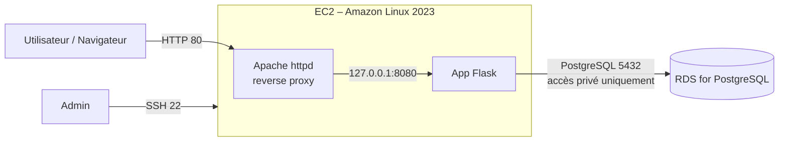
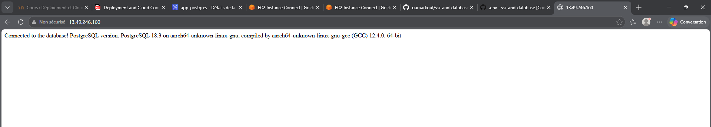
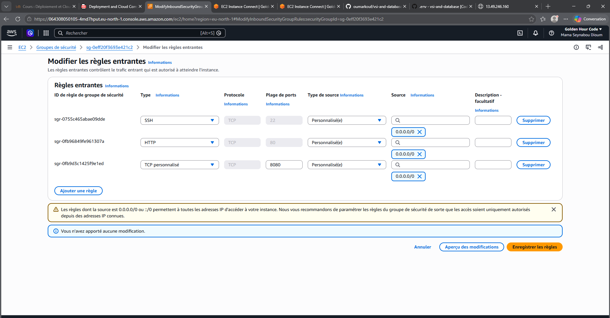
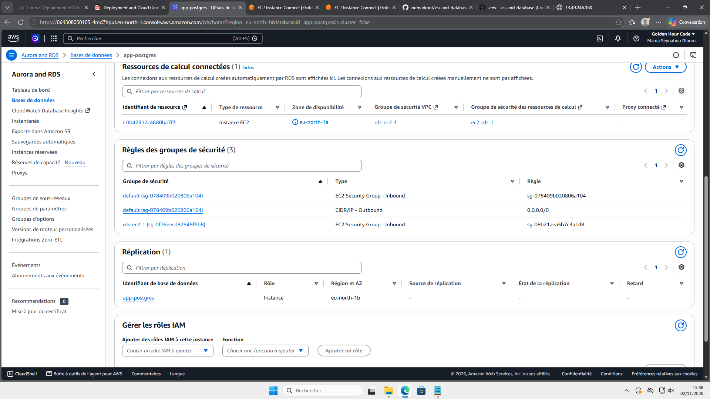

# TP – Application web sur VM (IaaS) avec base de données managée (PaaS)

Déploiement d'une application Python/Flask sur une instance **AWS EC2** connectée à une base **Amazon RDS for PostgreSQL**, avec un reverse proxy **Apache** en bonus.

Auteure : Mama Seynabou Dioum – ESIGELEC

## Architecture



| Composant | Service AWS | Détail |
|---|---|---|
| VM (IaaS) | EC2 | Amazon Linux 2023, région `eu-north-1` |
| Base de données (PaaS) | RDS for PostgreSQL | PostgreSQL 18, accès public désactivé |
| Filtrage réseau | Security Groups | voir section Sécurité |
| Reverse proxy (bonus) | Apache httpd | port 80 vers Flask sur 8080 |

## Sécurité réseau

**Security Group de l'EC2 (entrant)**

| Port | Source | Rôle |
|---|---|---|
| 22 (SSH) | IP de l'administrateur | administration |
| 80 (HTTP) | 0.0.0.0/0 | accès public via Apache |
| 8080 (TCP) | 0.0.0.0/0 | accès direct à Flask |

**Security Group de la RDS (entrant)**

| Port | Source | Rôle |
|---|---|---|
| 5432 (PostgreSQL) | Security Group de l'EC2 | seule la VM peut joindre la base |

La base n'est pas accessible publiquement : elle n'est joignable que depuis l'EC2, dans le même VPC.

Le mot de passe de la base n'est jamais versionné. Il est stocké dans un fichier `.env`, présent uniquement sur la VM et listé dans `.gitignore`.

## Déploiement

### 1. Infrastructure

L'EC2 et la RDS ont été créées via la console AWS. La connexion EC2 → RDS a été configurée avec l'option RDS « Configurer une connexion EC2 », qui crée les règles de Security Group autorisant uniquement l'instance sur le port 5432.

### 2. Installation sur l'EC2

Connexion via EC2 Instance Connect (ou `ssh -i <clé> ec2-user@<IP_EC2>`), puis :

```bash
sudo yum install -y python3 python3-pip git
git clone <url-du-depot>
cd vsi-and-database
python3 -m venv .venv
source .venv/bin/activate
pip install -r requirements.txt
```

### 3. Configuration

Créer le fichier `.env` sur la VM :

```dotenv
DB_HOST=<endpoint-rds>.eu-north-1.rds.amazonaws.com
DB_NAME=postgres
DB_USER=postgres
DB_PASS=<mot-de-passe>
DB_PORT=5432
```

### 4. Lancement

```bash
set -a; source .env; set +a
python3 app.py
```

L'application écoute sur `0.0.0.0:8080`.

### 5. Bonus – Apache en reverse proxy (port 80)

```bash
sudo yum install -y httpd
echo 'ProxyPass / http://127.0.0.1:8080/
ProxyPassReverse / http://127.0.0.1:8080/' | sudo tee /etc/httpd/conf.d/flask.conf
sudo systemctl enable --now httpd
```

Puis ajout d'une règle entrante HTTP (80) dans le Security Group de l'EC2.

## Tests

| Requête | Résultat attendu | Résultat obtenu |
|---|---|---|
| `GET /health` | `{"status":"ok"}` | OK |
| `GET /` | version de PostgreSQL | `Connected to the database! PostgreSQL version: PostgreSQL 18.3 ...` |

Captures d'écran :





## Problèmes rencontrés et solutions

| Symptôme | Cause | Solution |
|---|---|---|
| Erreur 500 sur `/` quand l'app tourne dans le Codespace | La RDS n'est pas publique, le Codespace ne peut pas la joindre | Exécuter l'application sur l'EC2 |
| `Missing environment variable: 'DB_PASS'` | Ligne absente du `.env` (caractère spécial mal interprété par `echo` entre guillemets doubles) | Ajouter la ligne avec des guillemets simples, puis recharger `.env` |
| `/health` OK mais `/` en timeout vers le port 5432 | La RDS utilisait le Security Group `default`, qui n'autorisait pas celui de l'EC2 | Autoriser le Security Group de l'EC2 sur le port 5432 |
| Timeout dans le navigateur sur le port 8080, alors que `curl` depuis le Codespace fonctionne | Le réseau local bloque le port 8080 en sortie | Passer par Apache sur le port 80 (bonus) |

## Limites et améliorations possibles

- L'infrastructure a été créée manuellement via la console. Une amélioration serait de la décrire en **Terraform** (`main.tf`, `variables.tf`, `outputs.tf`), avec le mot de passe en variable sensible (`TF_VAR_db_password`).
- L'installation pourrait être automatisée avec un **playbook Ansible**.
- Lancer Flask comme service `systemd` pour qu'il redémarre automatiquement.
- Ajouter HTTPS (Let's Encrypt).

## Nettoyage

Après les tests, toutes les ressources ont été supprimées pour éviter des frais :

- instance RDS supprimée (sans snapshot final)
- instance EC2 terminée
- Security Groups créés pour le TP supprimés
- vérification qu'il ne reste aucun volume EBS ni snapshot

## Fichiers non versionnés

Le `.gitignore` exclut :

```
.env
*.tfstate
*.tfstate.*
*.tfvars
.terraform/
*.pem
```
