# TP – Application web derrière un load balancer HTTPS (IaaS + PaaS sur AWS)

Auteure : Mama Seynabou Dioum – ESIGELEC
Région AWS : `eu-north-1` (Stockholm)

Ce dépôt contient deux parties :

1. **Partie 1** : une VM EC2 (IaaS) avec l'application Flask, connectée à une base RDS for PostgreSQL (PaaS).
2. **Partie 2** : deux VMs identiques derrière un **Application Load Balancer HTTPS**, avec health check, répartition de charge et bascule en cas de panne. Cette infrastructure a été déployée **deux fois** : en Terraform, puis à la main dans la console AWS.

---

## Architecture finale (partie 2)

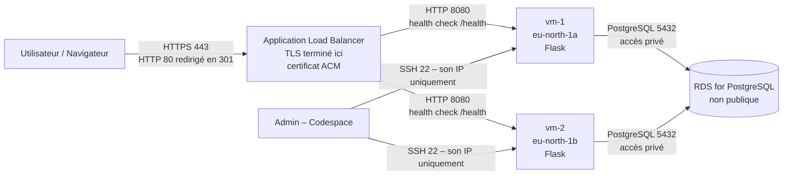

| Composant | Service AWS | Détail |
|---|---|---|
| 2 VMs (IaaS) | EC2 `t3.micro` | Amazon Linux 2023, `vm-1` et `vm-2` dans deux zones différentes |
| Load balancer | Application Load Balancer | public, écouteur HTTPS 443 + redirection HTTP 80 → 443 |
| Certificat TLS | ACM (importé) | auto-signé, CN `lab-lb.example.com`, valable 30 jours |
| Target group | `tp-app-tg` | HTTP 8080, health check `/health` toutes les 10 s, seuils 2/2 |
| Base (PaaS) | RDS for PostgreSQL `db.t3.micro` | PostgreSQL 18, accès public désactivé, base `appdb` |
| Filtrage réseau | 3 Security Groups | voir ci-dessous |
| App | Flask en service `systemd` (`flask-app`) | routes `/`, `/health`, `/whoami`, en-tête `X-Served-By` |

---

## Sécurité réseau

| Security Group | Entrant | Sortant | Rôle |
|---|---|---|---|
| `tp-alb-sg` | 443 et 80 depuis `0.0.0.0/0` | tout | seul point d'entrée public |
| `tp-vm-sg` | 8080 **depuis `tp-alb-sg`**, 22 depuis l'IP de l'admin (`/32`) | tout | les VMs ne sont plus exposées directement |
| `tp-db-sg` | 5432 **depuis `tp-vm-sg`** | tout | seule une VM peut joindre la base |

Les sources des règles 8080 et 5432 sont des **groupes de sécurité** et non des adresses IP : une nouvelle VM placée dans `tp-vm-sg` est autorisée automatiquement, et rien d'autre ne l'est.

**`tp-alb-sg`**

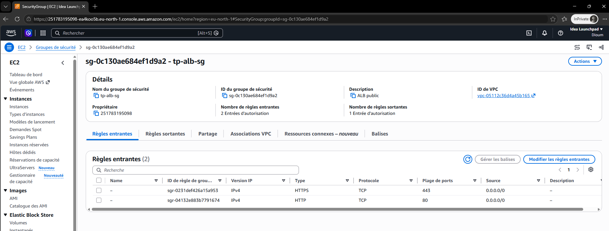
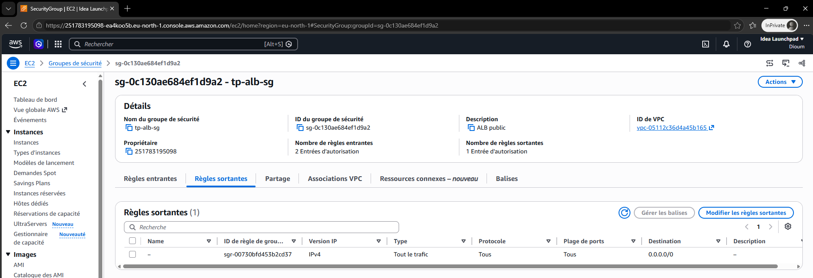

**`tp-vm-sg`** : 8080 uniquement depuis le SG de l'ALB, SSH uniquement depuis une IP

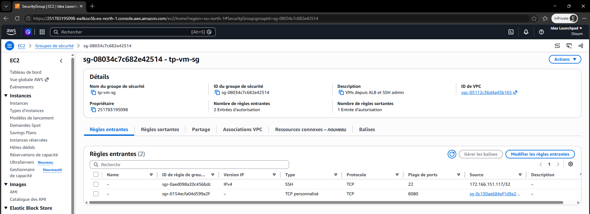
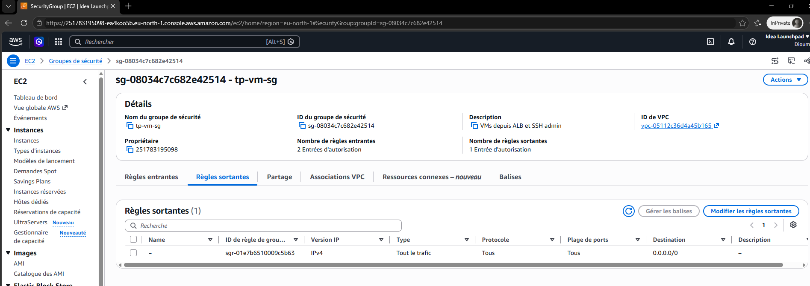

**`tp-db-sg`** : 5432 uniquement depuis le SG des VMs

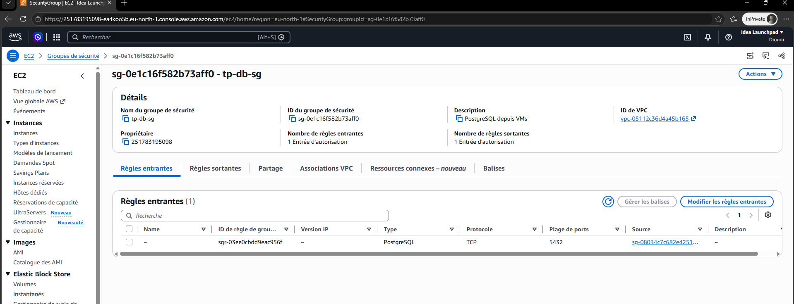
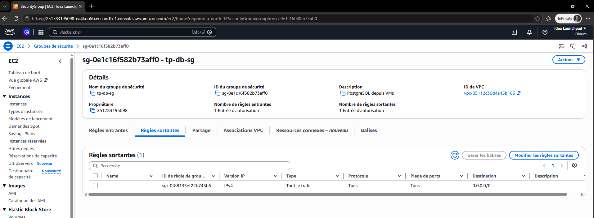

---

## Déploiement avec Terraform

Le code se trouve dans [`terraform/`](terraform/) :

| Fichier | Contenu |
|---|---|
| `main.tf` | Security Groups, RDS, clé SSH, 2 instances EC2, certificat TLS + import ACM, ALB, target group, écouteurs |
| `variables.tf` | région, mot de passe de la base (variable `sensitive`), type d'instance, nombre de VMs… |
| `outputs.tf` | DNS du load balancer, IP publiques des VMs, commandes SSH, endpoint de la base, ARN du target group |
| `user_data.sh.tftpl` | script de démarrage des VMs : installation, clone de l'app, `.env`, service `systemd` |

Choix techniques :
- **Aucun secret dans le code** : le mot de passe est passé par `TF_VAR_db_password`.
- **SSH restreint automatiquement** : l'IP de la machine qui lance Terraform est récupérée (`checkip.amazonaws.com`) et seule elle est autorisée sur le port 22.
- **Déploiement de l'app par `user_data`** plutôt qu'Ansible : chaque VM s'installe seule au premier démarrage, avec un nom d'hôte `vm-1` / `vm-2`.
- **Certificat généré par Terraform** (provider `tls`) puis importé dans ACM : pas de fichier de clé à manipuler.
- **Health check rapide** (10 s, 2 échecs) et `deregistration_delay = 10` pour une bascule visible en moins de 30 s.

### Commandes

```bash
# prérequis : aws configure (utilisateur IAM, pas root), clé SSH
ssh-keygen -t ed25519 -f ~/.ssh/tp-lb -N ""
export TF_VAR_db_password='<mot-de-passe>'

cd terraform
terraform init
terraform fmt && terraform validate
terraform plan        # Plan: 16 to add
terraform apply
```

Résultat :

```text
Success! The configuration is valid.
Plan: 16 to add, 0 to change, 0 to destroy.

Outputs:
lb_dns_name   = "tp-app-alb-1669223596.eu-north-1.elb.amazonaws.com"
ssh_commands  = { vm-1 = "ssh -i ~/.ssh/tp-lb ec2-user@...", vm-2 = "ssh -i ~/.ssh/tp-lb ec2-user@..." }
db_endpoint   = "app-postgres.xxxx.eu-north-1.rds.amazonaws.com"
```

## Déploiement manuel dans la console AWS

La même architecture a ensuite été recréée à la main :

1. **Security Groups** `tp-alb-sg`, `tp-vm-sg`, `tp-db-sg` (dans cet ordre, chacun référence le précédent)
2. **RDS** PostgreSQL `db.t3.micro`, accès public **Non**, SG `tp-db-sg`, base initiale `appdb`
3. **Paire de clés** importée depuis la clé publique du Codespace
4. **2 instances EC2** dans deux zones, SG `tp-vm-sg`, même script de démarrage dans les « Données utilisateur »
5. **Target group** `tp-app-tg` : HTTP 8080, `/health`, les 2 instances enregistrées
6. **Certificat** généré avec `openssl` puis importé dans **ACM** :
   ```bash
   openssl req -x509 -newkey rsa:2048 -nodes -days 30 -keyout lb.key -out lb.crt \
     -subj "/CN=lab-lb.example.com" -addext "subjectAltName=DNS:lab-lb.example.com"
   ```
7. **ALB** `tp-app-alb` : public, toutes les zones, SG `tp-alb-sg`, écouteur HTTPS 443 → `tp-app-tg` avec le certificat ACM, puis écouteur HTTP 80 → redirection 301 vers HTTPS

---

## Tests et preuves

### 1. Les cibles sont saines

```text
$ aws elbv2 describe-target-health --target-group-arn <arn> \
    --query 'TargetHealthDescriptions[].[Target.Id,TargetHealth.State]' --output table
+----------------------+-----------+
|  i-0226f4b59103c1015 |  healthy  |
|  i-0d9f2c85c6c2388bb |  healthy  |
+----------------------+-----------+
```

### 2. L'application et la base répondent en HTTPS via le load balancer

```text
$ curl -sk https://$LB/
Connected to the database! PostgreSQL version: PostgreSQL 18.3 on x86_64-pc-linux-gnu ...
```

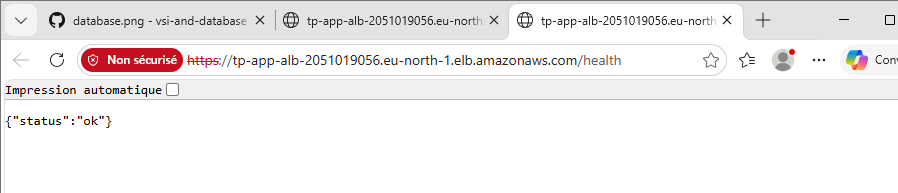

### 3. Le certificat TLS

Le navigateur affiche « Non sécurisé » car le certificat est **auto-signé** (émis par et pour `lab-lb.example.com`), mais la connexion est bien chiffrée en TLS jusqu'à l'ALB. En production, on utiliserait un vrai domaine avec un certificat ACM validé par DNS.

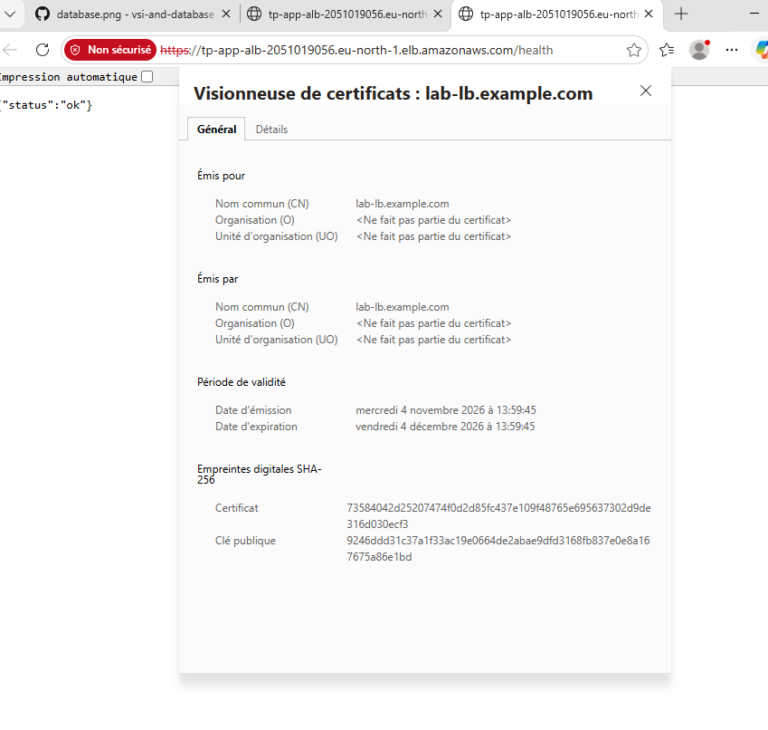

### 4. La répartition de charge

En actualisant `https://<lb-dns>/whoami`, la réponse vient tantôt de `vm-1`, tantôt de `vm-2` :

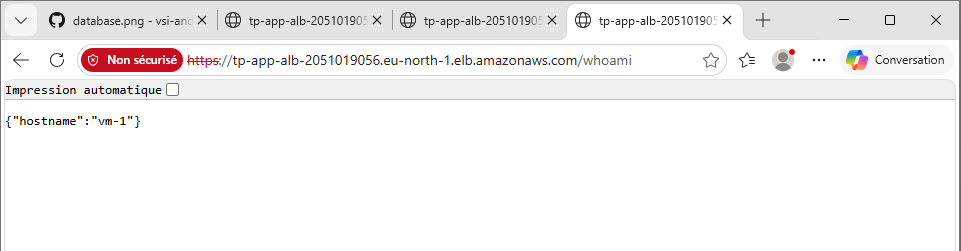
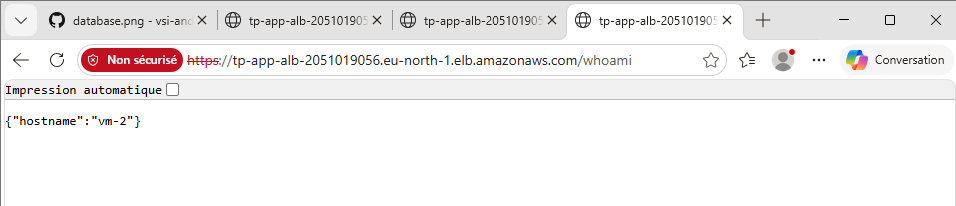

Avec le script fourni, sur 20 requêtes : **11 pour `vm-1`, 9 pour `vm-2`**. L'en-tête `x-served-by` indique la VM qui a répondu, et `HTTP/2 200` confirme le passage en HTTPS.

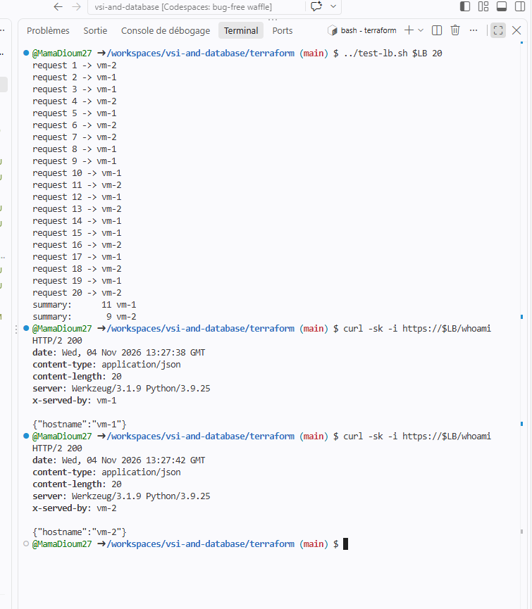

La répartition n'est pas strictement alternée car l'ALB a un nœud par zone et chacun fait son propre tourniquet. L'important est que les deux VMs servent du trafic.

### 5. Haute disponibilité : panne de `vm-1`

```bash
ssh -i ~/.ssh/tp-lb ec2-user@<ip-vm-1> 'sudo systemctl stop flask-app'
```

Après environ 20 secondes (2 health checks ratés), `vm-1` est retirée :

```text
+----------------------+-------------+
|  i-058a23a0ad86209b5 |  healthy    |
|  i-0b5fe83cb00a518c9 |  unhealthy  |
+----------------------+-------------+

$ ./test-lb.sh $LB 20
request 1 -> vm-2
...
request 20 -> vm-2
summary:      20 vm-2
```

**Les 20 requêtes sont servies par `vm-2` : l'application reste disponible.** Après `sudo systemctl start flask-app`, `vm-1` repasse `healthy` et le trafic est à nouveau partagé.

---

## Problèmes rencontrés et solutions

| Symptôme | Cause | Solution |
|---|---|---|
| `InvalidParameterValue: Invalid security group description` | AWS refuse l'apostrophe dans la description d'un SG | Description sans apostrophe ni accent |
| `UnsupportedCertificate: must have a fully-qualified domain name` | Le certificat avait le CN `lab-lb`, sans domaine complet | CN `lab-lb.example.com` + nom alternatif (SAN) |
| `502 Bad Gateway` sur toutes les requêtes (version console) | Au premier démarrage, `dnf install` a échoué (timeout réseau sortant) : l'app n'a jamais été installée et rien n'écoutait sur 8080 | Vérification de l'accès sortant, puis relance du script de démarrage sur chaque VM (`/var/lib/cloud/instance/scripts/part-001`) |
| Une seule VM répond juste après l'installation | La 2e cible n'était pas encore `healthy` (2 health checks nécessaires) | Attendre ~30 s avant le test |
| `git push` refusé (403) | Le Codespace était un clone du dépôt du prof | Fork + `gh auth login` + `gh auth setup-git` |

Pour diagnostiquer : un **502** signifie que l'ALB atteint la VM mais que rien ne répond sur 8080 (app arrêtée) ; un **504** signifie un timeout (Security Group fermé) ; un **503** signifie qu'aucune cible n'est enregistrée.

---

## Partie 1 (rappel) : une VM et une base RDS

Une première version, sans load balancer, exposait directement la VM (port 8080, puis port 80 via Apache en reverse proxy, en bonus).


---

## Nettoyage

Après les tests, tout a été supprimé pour éviter des frais (l'ALB et la RDS sont facturés à l'heure) :

- Terraform : `terraform destroy`
- Console, dans l'ordre : ALB → target group → instances → RDS (sans snapshot final) → certificat ACM → Security Groups → paire de clés
- Vérification qu'il ne reste aucun volume EBS

## Fichiers non versionnés

```
.env
.terraform/
*.tfstate
*.tfstate.*
*.tfvars
*.pem
lb.key
```
