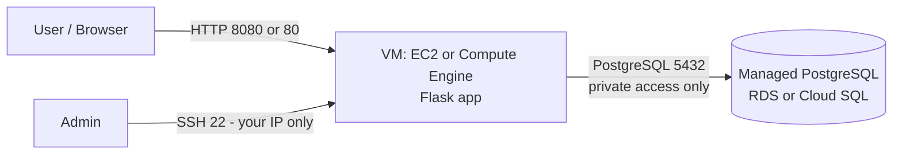

# Lab: Deploy a Web App on a VM (IaaS) with a Managed Database (PaaS)

## Objectives

By the end of this lab you will be able to:

- Provision cloud infrastructure as code with **Terraform**
- Deploy a **VM (IaaS)** and a **managed SQL database (PaaS)** on AWS or GCP
- Secure network access (Security Group / firewall, SSH keys)
- Configure a server with **Ansible** (or shell commands as a fallback)
- Deploy and test a Python/Flask application connected to PostgreSQL

## Target architecture



| Component | AWS | GCP |
|---|---|---|
| VM (IaaS) | EC2 (Amazon Linux / Ubuntu) | Compute Engine (Ubuntu) |
| Database (PaaS) | RDS for PostgreSQL | Cloud SQL for PostgreSQL |
| Network filtering | Security Groups | VPC firewall rules |
| CLI | AWS CLI | gcloud CLI |

> Choose **one** provider. The sample app uses PostgreSQL (`psycopg2`), so the database must be PostgreSQL.

## Prerequisites

- A cloud account (AWS or GCP) with billing/free tier enabled and a budget alert set
- Git, and a terminal
- Docs: [gcloud install](https://cloud.google.com/sdk/docs/install-sdk) -
  [AWS CLI install](https://docs.aws.amazon.com/cli/latest/userguide/getting-started-install.html)

## Steps

### 1. Prepare your tools
1. Install the CLI of your provider and authenticate (`aws configure` or `gcloud auth login`).
2. Install [Terraform](https://developer.hashicorp.com/terraform/install) and check with `terraform version`.
3. Generate an SSH key pair if you do not have one: `ssh-keygen -t ed25519`.

### 2. Provision the infrastructure with Terraform
Write Terraform code (`main.tf`, `variables.tf`, `outputs.tf`) that creates:

- A VM (Amazon Linux or Ubuntu) with your SSH public key
- A managed PostgreSQL instance (smallest/free-tier size)
- Firewall rules:
  - SSH (22) restricted to **your IP** (not `0.0.0.0/0`)
  - App port (8080, or 80 if using Apache) open to the Internet
  - PostgreSQL (5432) reachable **only from the VM**, not from the Internet
- Outputs: VM public IP and database endpoint

Rules:
- Do **not** hardcode the DB password: use a sensitive variable (`TF_VAR_db_password`).
- Run `terraform fmt`, `terraform validate`, then `terraform plan` before `terraform apply`.

### 3. Configure SSH access
```bash
chmod 400 ~/.ssh/<your-key>
ssh -i ~/.ssh/<your-key> <user>@<vm-public-ip>
```
Default users: `ec2-user` (Amazon Linux), `ubuntu` (Ubuntu).

### 4. Install the software (Ansible recommended)
Write an Ansible playbook (inventory + `playbook.yml`) that installs Python 3, pip, Git and the app dependencies.
If you cannot use Ansible, run the commands manually:

| | Amazon Linux | Ubuntu |
|---|---|---|
| Update | `sudo yum update -y` | `sudo apt update && sudo apt upgrade -y` |
| Install | `sudo yum install -y python3 python3-pip git` | `sudo apt install -y python3 python3-pip python3-venv git` |

**Bonus:** install Apache HTTP (`httpd` / `apache2`) as a reverse proxy on port 80 forwarding to Flask on 8080.

### 5. Deploy the application
```bash
git clone <your-repository-url> && cd vsi-and-database
python3 -m venv .venv && source .venv/bin/activate
pip install -r requirements.txt
cp .env.example .env      # edit with your DB endpoint and password
set -a; source .env; set +a
python app.py
```

### 6. Test
- `curl http://<vm-public-ip>:8080/health` returns `{"status":"ok"}` (app is up)
- `curl http://<vm-public-ip>:8080/` returns the PostgreSQL version (database is reachable)

Troubleshooting:

| Symptom | Likely cause |
|---|---|
| Connection timeout from the browser | App port not open in the Security Group / firewall |
| `/health` OK but `/` fails with a timeout | DB firewall does not allow the VM, or wrong subnet/VPC |
| `password authentication failed` | Wrong `DB_USER` / `DB_PASS` |
| `Missing environment variable` | `.env` not loaded in the current shell |

### 7. Clean up (mandatory)
```bash
terraform destroy
```
Verify in the console that no VM, database or disk remains, to avoid unexpected costs.

## Deliverables

- A Git repository containing: Terraform code, Ansible playbook (if used), `app.py`, `requirements.txt`
- A short README (how to deploy) and screenshots of the working app
- No secrets in the repository (`.env`, `*.tfstate`, `*.tfvars`, keys must be listed in your `.gitignore`)

## Going further

- Run the app as a `systemd` service so it restarts automatically
- Add HTTPS (Let's Encrypt)
- Add a Terraform remote state backend (S3 / GCS)
